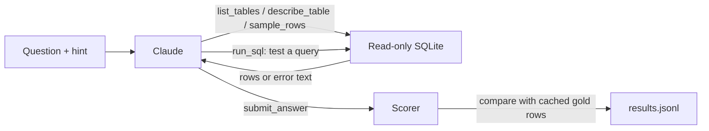

# text_to_sql_agent

[](https://github.com/JihanS07/text_to_sql_agent/actions/workflows/ci.yml)

An LLM agent that answers plain-English questions about a SQL database, plus the harness that
measures how well it does. The agent is written directly on the Claude Messages API with no agent
framework. It is tested on BIRD Mini-Dev, a public benchmark of 500 questions over 11 real databases.

The agent itself is small. Most of the code measures it: every configuration is run on the same
questions, each one changes a single thing, and every accuracy comes with a confidence interval and
a paired significance test. Cost and latency are recorded for every question.

Status: the harness, agent, tests and CI are done. Model runs are next, so for now the results table
only has the harness check.

## How the agent works



One step is one model call. The model can look at the schema, read the dataset's column notes,
look at real rows, test queries, and see its own errors. It ends by calling `submit_answer`. The
loop also stops on a step cap (12), a token budget or an API failure, and every run records which
of these happened.

## Results

Execution accuracy (EX) on BIRD Mini-Dev, July 2025 release. Strategies are listed so that each one
changes one thing relative to the one above it.

| Strategy | What changes |
|---|---|
| `single_schema` | One call. The prompt holds the CREATE statements only. |
| `single_rows` | Adds 3 example rows per table. |
| `single_rows_desc` | Adds BIRD's column descriptions. |
| `agent_no_exec` | Agent that explores the schema but cannot run its own queries. |
| `agent` | Full agent: explore, run queries, fix errors, submit. |
| `oracle` | Submits the gold SQL. Checks the harness. |

<!-- results:start -->
| Strategy | Model | Hint | n | EX % (95% CI) | Simple | Moderate | Challenging | Tool calls/q | Exec errors | $/question | Median latency (s) |
|---|---|---|---|---|---|---|---|---|---|---|---|
| oracle | none | yes | 500 | 99.8 (99.4-100.0) | 100.0 | 100.0 | 99.0 | 0.0 | 0.2% | 0.0000 | 0.0 |
<!-- results:end -->

Model runs pending. Paired comparisons (`sqlagent compare`) and the failure analysis will be added
below once they exist.

## What testing the harness turned up

The best possible score is 99.6 to 99.8%, not 100%, and it depends on the machine. Two gold queries
are slow on SQLite: question 701 took 325s and question 518 took 62s when run alone. Predicted
queries get 60 seconds, so 701 always times out and 518 passes or fails depending on machine load.
Two oracle runs on the same machine scored 99.6% and 99.8%, so scores from different machines are
not directly comparable.

The two releases of the dataset differ. The 2024 package has 498 questions and the July 2025 release
on Hugging Face has 500, with different gold SQL for two of the shared questions. This repo uses the
2025 release ([decision 0001](docs/decisions/0001-benchmark.md)).

Several of BIRD's column description files have a trailing comma in the header row. A normal CSV
reader then drops the value notes, which are the part the agent needs most, for example that
`POPLATEK MESICNE` means a monthly statement. `data.py` keeps them, and a test checks it.

## Design choices

Each one has a short decision record in [docs/decisions](docs/decisions/README.md).

The database is read-only at the connection level (`mode=ro`), so SQLite refuses every write no
matter what SQL the model sends. sqlglot checks each query first only to give the agent a clearer
error message. A test runs `DELETE` with that check turned off to show the connection still refuses.

Scoring uses BIRD's official rule, `set(pred_rows) == set(gold_rows)`, so the numbers can be
compared with published results. Tests pin down where that rule is too lenient or too strict, and
[decision 0004](docs/decisions/0004-scoring.md) lists the cases. Gold results are computed once and
cached.

Every accuracy has a 95% bootstrap confidence interval. Question samples are seeded so every
strategy sees the same questions, and `sqlagent compare` runs an exact McNemar test on each pair.

Cost comes from the token counts the API returns, including prompt cache reads and writes. Prices
are kept in `pricing.py`, so old runs can be re-priced.

The `sqlagent` CLI is the main runner because it can resume a run and compare two runs. An
[Inspect AI](https://inspect.aisi.org.uk/) task runs the same agent and scorer and adds structured
logs and a transcript viewer.

## Quickstart

Requires Python 3.12+ and [uv](https://docs.astral.sh/uv/).

```bash
make install                 # dependencies, dev tools, git hooks
make data                    # BIRD Mini-Dev (800 MB download), checksum check, gold cache
cp .env.example .env         # then add ANTHROPIC_API_KEY

make oracle                  # harness check, no API key needed, expect 99.6 to 99.8%
make smoke                   # agent on 20 questions
uv run sqlagent run --strategy agent --limit 100 --model claude-haiku-5-5
uv run sqlagent compare runs/<run A> runs/<run B>
uv run sqlagent show runs/<run> <question_id>     # full trace of one question
uv run sqlagent failures runs/<run>               # CSV of wrong answers to label

uv run inspect eval evals/bird_inspect.py --model mockllm/model -T strategy=agent -T limit=20
uv run inspect view
```

## Repository layout

```
src/sql_agent_eval/
  agent.py        the agent loop and prompts
  tools.py        tool definitions and their implementations
  db.py           read-only SQLite access, time limit, row cap
  strategies.py   the ablation configurations
  scoring.py      execution accuracy and the gold-result cache
  runner.py       concurrent, resumable evaluation runs
  report.py       tables, bootstrap intervals, McNemar test
  llm.py          Claude client with prompt caching, and a scripted fake for tests
  pricing.py      per-model token prices
  cli.py          `sqlagent` command
evals/            Inspect AI task
tests/            offline tests (no API key, no download)
docs/decisions/   decision records
docs/PLAN.md      the three-day plan
```

## Engineering setup

| Tool | Used for |
|---|---|
| uv | dependency management with a lock file |
| Ruff | linting and formatting |
| Pyright | static type checking |
| pytest | 32 offline tests, using a scripted model in place of the API |
| pre-commit | lint, format, tests and a secret-key check on every commit |
| GitHub Actions | the same checks on every push and pull request |
| sqlglot | SQL parsing for the read-only check |
| Inspect AI | second runner with structured logs and a viewer |

## Limitations

- One benchmark, SQLite only. Results may not carry over to other databases or SQL dialects.
- BIRD's scoring ignores row order and duplicates and can count a coincidental match as correct.
- Model outputs are not deterministic. The plan includes repeated runs to measure the spread.
- Some BIRD gold labels are known to contain errors. A corrected 2026 release exists and is future work.

## Data and license

Code: MIT. BIRD Mini-Dev is released under CC BY-SA 4.0 by its authors
([paper](https://arxiv.org/abs/2305.03111), [repository](https://github.com/bird-bench/mini_dev)).
The data is downloaded by `make data` and is not stored in this repo.
